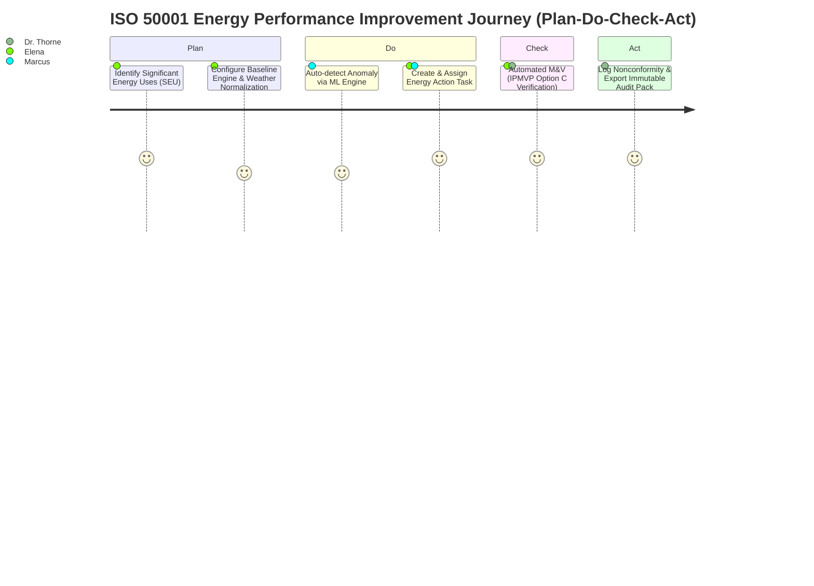

# 3. Personas and Key Journeys

## 3.1 Primary Target Personas

### 1. Elena Rostova — Lead Energy Manager
- **Role**: Responsible for multi-site energy performance, ISO 50001 certification maintenance, and decarbonization roadmap execution.
- **Goals**: Establish accurate baselines, identify significant energy uses (SEUs), execute energy saving projects, and demonstrate verified ROI to leadership.
- **Pain Points**: Manual data aggregation across fractured systems, unreliable regression baselines, lack of M&V standardization.

### 2. Marcus Vance — Chief Facility Operator / Maintenance Engineer
- **Role**: Oversees day-to-day HVAC, lighting, electrical, and boiler equipment operations.
- **Goals**: Maintain operational continuity, keep occupant satisfaction high, fix equipment breakdowns before failure.
- **Pain Points**: Alarm fatigue from false alerts, inability to distinguish sensor failures from real energy waste, opaque black-box recommendations.

### 3. Dr. Aris Thorne — ISO 50001 Lead Auditor
- **Role**: Third-party or internal auditor evaluating EnMS compliance.
- **Goals**: Verify data integrity, trace EnPI changes, inspect decision records, and ensure PDCA nonconformity closure.
- **Pain Points**: Incomplete logs, non-verifiable baselines, lack of data lineage for manual spreadsheet entries.

### 4. Sarah Jenkins — Executive VP of Sustainability & Operations
- **Role**: C-suite executive driving corporate ESG targets, Scope 1/2 GHG reductions, and energy cost optimization.
- **Goals**: Real-time executive dashboards, reliable CBAM/GHG compliance reporting, clear ROI metrics for capital investments.
- **Pain Points**: High-level vanity metrics disconnected from ground-level operational realities.

### 5. Tom Miller — SME Facility Owner / Site Administrator
- **Role**: Owner/Manager of a mid-sized commercial building or discrete manufacturing plant with limited dedicated energy staff.
- **Goals**: Fast turnkey deployment, zero-friction setup, immediate low-hanging fruit energy savings.
- **Pain Points**: Complex enterprise software requiring dedicated IT/data teams; prohibitive upfront licensing costs.

---

## 3.2 Key User Journeys & Acceptance Criteria

### Journey 1: Establishing ISO 50001 Baseline & EnPI Normalization
1. **Trigger**: Energy Manager sets up a new building asset or production line for ISO 50001 tracking.
2. **Steps**:
   - Selects target meter(s) and defines independent variables (e.g., Heating Degree Days - HDD, Cooling Degree Days - CDD, Production Volume).
   - VerdantOS runs multi-variable linear regression (MLR) or non-linear polynomial fit over a selectable historical period (e.g., 12 months).
   - System evaluates statistical validity ($R^2 > 0.8$, $p\text{-value} < 0.05$, $t\text{-statistic}$) and presents baseline model equation.
   - Manager saves baseline model as active baseline version 1.0.
3. **Acceptance Criteria**:
   - System flags baseline model if $R^2 < 0.75$ with specific diagnostic advice (e.g., "Add occupancy schedule variable").
   - Immutable baseline version history created in audit log.

### Journey 2: Anomaly Detection, Triage, and Closed-Loop Action Tracking
1. **Trigger**: Anomaly engine detects abnormal 30% power spike on Chiller #2 during non-operational hours.
2. **Steps**:
   - Operator receives enriched alert: "Chiller #2 drawing 120 kW vs expected 45 kW (Baseload offset). Root cause probability: Schedule bypass / stuck valve (88%)."
   - Operator acknowledges alert and converts it into a PDCA Action Item assigned to HVAC contractor.
   - Action item tracks expected savings ($4,200/month) vs. realized savings via IPMVP M&V module post-fix.
3. **Acceptance Criteria**:
   - Alert must include sensor health validation to rule out bad telemetry prior to triggering high-priority notification.
   - Realized savings automatically computed 30 days post-resolution using baseline comparison.
