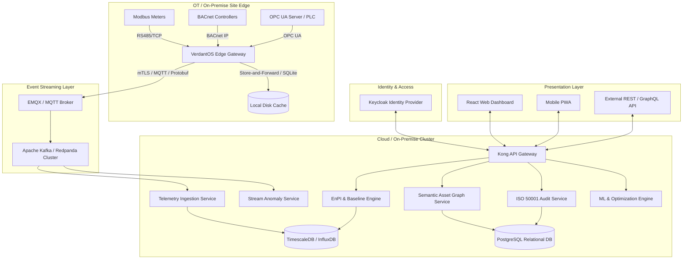

# 4. High-Level Architecture: Edge-Cloud, Microservices & Event-Driven Topology

## 4.1 System Topology Overview
VerdantOS uses an event-driven, hybrid edge-cloud microservices architecture designed for zero single-point-of-failure operation, sub-second telemetry processing, and strict multi-tenant isolation.



## 4.2 Edge Architecture & Store-and-Forward Resiliency
- **Edge Gateway Runtime**: Containerized Docker application running on Industrial Linux x86/ARM (Go / Rust runtime).
- **Protocol Adapters**: Modbus RTU/TCP, BACnet/IP, OPC UA, MQTT, SNMP, DL/T645, IEC 61850.
- **Store-and-Forward Engine**:
  - Local disk queue using SQLite / embedded RocksDB.
  - Automatic telemetry payload compression (Zstandard).
  - Guarantees zero data loss during WAN network outages for up to 60 days (configurable retention).
  - Edge-to-cloud time synchronization using PTP (IEEE 1588) or NTP with timestamp back-filling on reconnection.

## 4.3 Cloud Microservices & Storage Architecture
1. **API Gateway (Kong / Envoy)**: Handles rate limiting, mTLS termination, JWT validation, and multi-tenant request routing.
2. **Telemetry Ingestion Service (Go)**: Consumes Protobuf payloads from Kafka, validates schema, applies real-time unit conversion and scaling factors, and writes to TSDB.
3. **Semantic Asset Graph Service (Java Spring / Go)**: Manages asset hierarchies, relationships, and tags using PostgreSQL with `ltree` and JSONB extensions.
4. **EnPI & Baseline Engine (Python / Go)**: Executes dynamic formula evaluation DSL, multi-variable linear regressions, weather normalization (HDD/CDD), and IPMVP M&V.
5. **Storage Decoupling**:
   - **Time-Series DB (TimescaleDB / InfluxDB)**: High-throughput ingestion (up to 500k points/sec), automatic data retention policies, and continuous aggregates.
   - **Relational DB (PostgreSQL 16+)**: Multi-tenant relational data, audit logs, user permissions, asset metadata, and action tracking with Row-Level Security (RLS).
   - **Cache & State Store (Redis Cluster)**: Session management, rate limiting, and real-time alert sliding-window buffers.

---

## 4.4 Event Envelope & Kafka Topic Catalog (R-05)

### Canonical Event Envelope (JSON Schema / Protobuf)
Every streaming message across VerdantOS Kafka topics adheres to this strict envelope structure:

```json
{
  "$schema": "http://json-schema.org/draft-07/schema#",
  "title": "VerdantOSEventEnvelope",
  "type": "object",
  "properties": {
    "event_id": { "type": "string", "format": "uuid" },
    "event_type": { "type": "string" },
    "schema_version": { "type": "string", "default": "1.0.0" },
    "tenant_id": { "type": "string", "format": "uuid" },
    "occurred_at": { "type": "string", "format": "date-time" },
    "recorded_at": { "type": "string", "format": "date-time" },
    "correlation_id": { "type": "string", "format": "uuid" },
    "causation_id": { "type": "string", "format": "uuid" },
    "producer": { "type": "string" },
    "payload": { "type": "object" }
  },
  "required": ["event_id", "event_type", "schema_version", "tenant_id", "occurred_at", "recorded_at", "correlation_id", "producer", "payload"]
}
```

### Kafka Topic Catalog

| Topic Name | Producer | Primary Consumers | Key Strategy | Partitions Rationale | Retention | Schema Compatibility | PII Class |
| :--- | :--- | :--- | :--- | :--- | :--- | :--- | :--- |
| `telemetry.raw.v1` | Edge Gateway | Ingestion Svc, Stream Anomaly Svc | `tenant_id:point_id` | 32 partitions (high volume) | 7 Days | `BACKWARD` | None |
| `telemetry.normalized.v1` | Ingestion Svc | TSDB Writer, EnPI Engine | `tenant_id:point_id` | 32 partitions | 7 Days | `BACKWARD` | None |
| `anomalies.detected.v1` | Stream Anomaly Svc | Notification Svc, Action Engine | `tenant_id:asset_id` | 16 partitions | 30 Days | `FULL` | None |
| `actions.pdca.v1` | Action Svc | Audit Svc, Notification Svc | `tenant_id:action_id` | 8 partitions | 365 Days | `FULL` | Low (Owner UUID) |
| `audit.events.v1` | Audit Svc | Hash-Chain Verifier, MinIO Archiver | `tenant_id` | 8 partitions | 3650 Days | `FULL` | Medium |

### Dead-Letter Queue (DLQ), Poison Message & Replay Semantics
1. **Dead-Letter Handling**: Messages failing processing 3 consecutive times due to schema or parsing errors are routed to `dlq.<topic_name>` with exception stack trace headers.
2. **Poison Message Policy**: Consumers skip poison payload after emitting alert to SRE channel; poison payload stored in MinIO for diagnostic replay.
3. **Replay Semantics**: Consumers support rewind by timestamp or offset parameter (`--replay-from-timestamp="2026-10-01T00:00:00Z"`), recalculating derived aggregates idempotently using primary keys.
