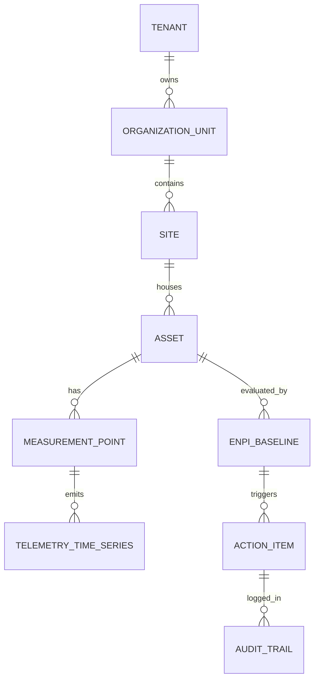

# 5. Domain and Data Model (with Audited DDL & Semantic Mapping)

## 5.1 Domain Entity Relationships
VerdantOS extends **Brick Schema** and **Project Haystack** concepts to model physical and logical relationships while closing critical gaps in audit support, versioning, M&V tracking, and sustainability metrics.



---

## 5.2 Brick Schema & Project Haystack Gap Closure Matrix

| Standard Class / Tag | VerdantOS Extension Entity | Purpose & Gap Closed | Rationale |
| :--- | :--- | :--- | :--- |
| `brick:Chiller` / `haystack:chiller` | `assets` (with `brick_class`) | Physical Asset Mapping | Standard physical model representation. |
| *No equivalent* | `enpi_baselines` | ISO 50001 Baseline & EnPI Gap | Brick/Haystack lack regression coefficients, statistical validation ($R^2$), and baseline versioning. |
| *No equivalent* | `action_items` | ISO 50001 PDCA Gap | No standard exists in Brick/Haystack for energy improvement projects, ROI, and M&V status. |
| *No equivalent* | `audit_trail` | Cryptographic Audit Trail Gap | Neither standard provides SHA-256 hash chaining or immutable change logs. |
| *No equivalent* | `production_contexts` | Industrial Attribution Gap | Lacks concept of manufacturing order, product batch, shift, or production tonnage. |
| *No equivalent* | `cbam_emission_factors` | Sustainability & Carbon Gap | No support for Scope 1/2 GHG emission factors or CBAM embedded carbon values. |

### Worked Example: AHU Protocol Signal to VerdantOS Entity
1. **OT Protocol Signal**: Modbus Register `40001` (Active Power, kW) on IP `192.168.1.50`.
2. **Project Haystack Tag Set**: `{"ahu": true, "elec": true, "power": true, "unit": "kW"}`.
3. **Brick Class**: `brick:Air_Handling_Unit` -> Point: `brick:Electrical_Power_Sensor`.
4. **VerdantOS Entity Binding**:
   - Asset: `AHU-Building-A-01` (`id: 8f2a...`, `path: tenant1.site_north.bldg_a.ahu_01`).
   - Measurement Point: `AHU-01 Power` (`point_type: active_power`, `unit: kW`).
   - Baseline Link: Evaluated by `EnPI-Baseline-AHU-2026-v1.0` ($kW = 5.2 + 0.12 \times \text{Occupancy}$).

---

## 5.3 Executable PostgreSQL Audited Schema (DDL SQL)

```sql
-- Enable necessary extensions
CREATE EXTENSION IF NOT EXISTS "uuid-ossp";
CREATE EXTENSION IF NOT EXISTS "ltree";

-- 1. Tenant Table (Multi-Tenancy Isolation)
CREATE TABLE tenants (
    id UUID PRIMARY KEY DEFAULT uuid_generate_v4(),
    name VARCHAR(255) NOT NULL,
    slug VARCHAR(64) UNIQUE NOT NULL,
    plan_tier VARCHAR(32) NOT NULL DEFAULT 'standard', -- 'standard', 'enterprise', 'dedicated'
    is_deleted BOOLEAN NOT NULL DEFAULT FALSE,
    created_at TIMESTAMPTZ NOT NULL DEFAULT NOW(),
    updated_at TIMESTAMPTZ NOT NULL DEFAULT NOW(),
    created_by UUID
);

-- 2. Organization Units
CREATE TABLE organization_units (
    id UUID PRIMARY KEY DEFAULT uuid_generate_v4(),
    tenant_id UUID NOT NULL REFERENCES tenants(id) ON DELETE CASCADE,
    name VARCHAR(255) NOT NULL,
    code VARCHAR(64) NOT NULL,
    is_deleted BOOLEAN NOT NULL DEFAULT FALSE,
    created_at TIMESTAMPTZ NOT NULL DEFAULT NOW(),
    updated_at TIMESTAMPTZ NOT NULL DEFAULT NOW(),
    created_by UUID NOT NULL
);

-- 3. Assets Hierarchy Table (Brick/Haystack Hybrid with ltree)
CREATE TABLE assets (
    id UUID PRIMARY KEY DEFAULT uuid_generate_v4(),
    tenant_id UUID NOT NULL REFERENCES tenants(id) ON DELETE CASCADE,
    org_unit_id UUID REFERENCES organization_units(id) ON DELETE SET NULL,
    parent_id UUID REFERENCES assets(id) ON DELETE SET NULL,
    path LTREE NOT NULL,
    name VARCHAR(255) NOT NULL,
    asset_type VARCHAR(64) NOT NULL, -- 'chiller', 'boiler', 'production_line', 'building'
    brick_class VARCHAR(128),
    haystack_tags JSONB DEFAULT '{}'::jsonb,
    attributes JSONB DEFAULT '{}'::jsonb,
    is_deleted BOOLEAN NOT NULL DEFAULT FALSE,
    created_at TIMESTAMPTZ NOT NULL DEFAULT NOW(),
    updated_at TIMESTAMPTZ NOT NULL DEFAULT NOW(),
    created_by UUID NOT NULL
);

CREATE INDEX idx_assets_path ON assets USING GIST (path);
CREATE INDEX idx_assets_tenant ON assets(tenant_id);

-- 4. Measurement Points Table
CREATE TABLE measurement_points (
    id UUID PRIMARY KEY DEFAULT uuid_generate_v4(),
    tenant_id UUID NOT NULL REFERENCES tenants(id) ON DELETE CASCADE,
    asset_id UUID NOT NULL REFERENCES assets(id) ON DELETE CASCADE,
    name VARCHAR(255) NOT NULL,
    point_type VARCHAR(64) NOT NULL, -- 'active_power', 'flow_rate', 'temperature'
    unit VARCHAR(32) NOT NULL,
    is_virtual BOOLEAN DEFAULT FALSE,
    virtual_formula TEXT,
    sampling_interval_seconds INT DEFAULT 60,
    is_deleted BOOLEAN NOT NULL DEFAULT FALSE,
    created_at TIMESTAMPTZ NOT NULL DEFAULT NOW(),
    updated_at TIMESTAMPTZ NOT NULL DEFAULT NOW(),
    created_by UUID NOT NULL
);

CREATE INDEX idx_points_tenant_asset ON measurement_points(tenant_id, asset_id);

-- 5. Time-Series Telemetry Table (Partitioned by Month)
CREATE TABLE telemetry_time_series (
    recorded_at TIMESTAMPTZ NOT NULL,
    point_id UUID NOT NULL,
    tenant_id UUID NOT NULL,
    value NUMERIC(18, 6) NOT NULL,
    quality_flag VARCHAR(32) NOT NULL DEFAULT 'GOOD', -- 'GOOD', 'BAD_SENSOR_FAULT', 'ESTIMATED'
    PRIMARY KEY (recorded_at, point_id, tenant_id)
) PARTITION BY RANGE (recorded_at);

-- Partition Example
CREATE TABLE telemetry_y2026m10 PARTITION OF telemetry_time_series
    FOR VALUES FROM ('2026-10-01 00:00:00+00') TO ('2026-11-01 00:00:00+00');

-- 6. EnPI Baselines
CREATE TABLE enpi_baselines (
    id UUID PRIMARY KEY DEFAULT uuid_generate_v4(),
    tenant_id UUID NOT NULL REFERENCES tenants(id) ON DELETE CASCADE,
    asset_id UUID NOT NULL REFERENCES assets(id) ON DELETE CASCADE,
    name VARCHAR(255) NOT NULL,
    version INT NOT NULL DEFAULT 1,
    formula_dsl TEXT NOT NULL,
    r_squared NUMERIC(5, 4),
    p_value NUMERIC(6, 5),
    valid_from TIMESTAMPTZ NOT NULL,
    valid_to TIMESTAMPTZ,
    status VARCHAR(32) DEFAULT 'active',
    is_deleted BOOLEAN NOT NULL DEFAULT FALSE,
    created_at TIMESTAMPTZ NOT NULL DEFAULT NOW(),
    updated_at TIMESTAMPTZ NOT NULL DEFAULT NOW(),
    created_by UUID NOT NULL
);

-- 7. Action Items (PDCA)
CREATE TABLE action_items (
    id UUID PRIMARY KEY DEFAULT uuid_generate_v4(),
    tenant_id UUID NOT NULL REFERENCES tenants(id) ON DELETE CASCADE,
    asset_id UUID REFERENCES assets(id) ON DELETE CASCADE,
    title VARCHAR(255) NOT NULL,
    description TEXT,
    owner_id UUID NOT NULL,
    status VARCHAR(32) DEFAULT 'open',
    expected_annual_savings_kwh NUMERIC(12, 2),
    realized_annual_savings_kwh NUMERIC(12, 2),
    due_date DATE,
    is_deleted BOOLEAN NOT NULL DEFAULT FALSE,
    created_at TIMESTAMPTZ NOT NULL DEFAULT NOW(),
    updated_at TIMESTAMPTZ NOT NULL DEFAULT NOW(),
    created_by UUID NOT NULL
);

-- 8. Immutable Audit Trail
CREATE TABLE audit_trail (
    id UUID PRIMARY KEY DEFAULT uuid_generate_v4(),
    tenant_id UUID NOT NULL REFERENCES tenants(id) ON DELETE CASCADE,
    entity_type VARCHAR(64) NOT NULL,
    entity_id UUID NOT NULL,
    action_type VARCHAR(32) NOT NULL,
    changed_by UUID NOT NULL,
    payload_before JSONB,
    payload_after JSONB,
    cryptographic_hash VARCHAR(64) NOT NULL,
    previous_hash VARCHAR(64) NOT NULL,
    created_at TIMESTAMPTZ NOT NULL DEFAULT NOW()
);

-- RLS Enforcement Strategy
ALTER TABLE assets ENABLE ROW LEVEL SECURITY;
CREATE POLICY tenant_isolation_assets ON assets
    USING (tenant_id = current_setting('app.current_tenant_id', true)::UUID);

ALTER TABLE action_items ENABLE ROW LEVEL SECURITY;
CREATE POLICY tenant_isolation_action_items ON action_items
    USING (tenant_id = current_setting('app.current_tenant_id', true)::UUID);
```

---

## 5.4 Index Inventory & Query Optimization Matrix

| Table Name | Query Pattern Source Reference | Index Definition | Optimization Rationale |
| :--- | :--- | :--- | :--- |
| `assets` | Section 6.2 (Asset Tree Traversal) | `GIST(path)` | Enables sub-millisecond tree subtree filtering (`path <@ 'tenant1.site_a'`). |
| `measurement_points` | Section 6.3 (Telemetry Query) | `(tenant_id, asset_id)` | Fast lookup of sensor points for asset context. |
| `telemetry_time_series` | Section 6.1 (Time-Series Read/Write) | `(recorded_at DESC, point_id)` | Optimizes hypertable range scans and latest reading queries. |
| `action_items` | Section 6.6 (PDCA Action Search) | `(tenant_id, status)` | Fast dashboard rendering of active open action tasks. |
| `audit_trail` | Section 6.7 (ISO 50001 Evidence) | `(tenant_id, created_at DESC)` | Accelerates chronologically chained audit verification scans. |
