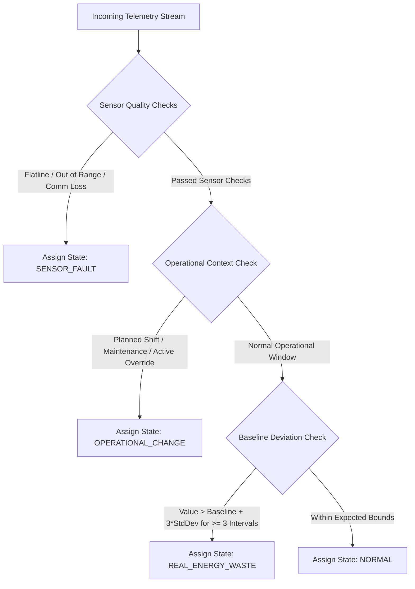

# 6. Functional Modules

## 6.1 Data Acquisition & Protocols
- **Supported OT Protocols**: Modbus TCP/RTU, OPC UA, BACnet/IP, MQTT/Sparkplug B, DL/T645, IEC 61850, SNMP v3, REST/HTTP webhook ingestion.
- **Edge Store-and-Forward**: Local disk buffer in SQLite/RocksDB with payload compression (Zstd) and timestamp back-filling upon WAN reconnection.
- **Data Quality Pipeline**:
  - Out-of-bounds filter (min/max validation).
  - Rate-of-change freeze detection (stuck sensor).
  - Outlier spike removal (Hampel filter / median filter).
  - Quality tagging: `GOOD`, `BAD_SENSOR_FAULT`, `ESTIMATED_INTERPOLATED`, `MANUAL_OVERRIDE`.

## 6.2 Semantic Layer & Asset Model
- **Hybrid Brick/Haystack Taxonomy**:
  - Full support for hierarchical asset relationships (`contains`, `isFedBy`, `controls`, `monitors`).
  - Graph API (GraphQL & REST) for traversing dependencies (e.g., "Find all AHUs fed by Chiller #1 and their downstream VAV boxes").
  - Versioned asset schema with historical tagging audit.

## 6.3 Metering, Sub-metering, Virtual Meters & Normalization
- **Virtual Meter Engine**:
  - Arithmetic and logic DSL to compute aggregate or difference consumption (e.g., `Virtual_Meter_Main = Meter_Sub1 + Meter_Sub2 - Meter_Solar`).
  - Handles missing meter sub-intervals via linear interpolation or historical profile matching.
- **Normalization Engine**:
  - Normalizes consumption across Degree Days (HDD/CDD), gross floor area ($m^2$), production tonnage, or operating hours.

## 6.4 EnPI and Baseline Engine
- **Regression Modeling**: Single and Multi-Variable Linear Regression (MLR), Polynomial regression, and Random Forest baseline modeling.
- **Statistical Rigor Criteria**: Automatically validates $R^2 \ge 0.75$, $p\text{-value} \le 0.05$, $t\text{-stat} > 2.0$, and relative standard error.
- **M&V (IPMVP Compliance)**: Automated baseline adjust vs actual tracking to derive verified savings following IPMVP Option A, B, and C guidelines.

## 6.5 Monitoring, Alerting & Tri-State Anomaly Detection
- **Tri-State Classification**:
  1. `SENSOR_FAULT`: Sudden drop to 0, invalid status code, communications loss.
  2. `OPERATIONAL_CHANGE`: Planned shift change, setpoint adjustment, schedule extension.
  3. `REAL_ENERGY_WASTE`: Unexplained baseline drift, off-hours baseload excess, low COP/efficiency.
- **Alert Escalation**: Multi-channel notifications (Email, SMS, Webhook, Slack, PagerDuty, MS Teams) with suppression and deduplication windows.

## 6.6 Action Management & PDCA Workflow
- **PDCA Lifecycle**: Assign actions, define expected ROI/kWh savings, track implementation progress, verify post-project performance via M&V.
- **Nonconformity Tracking**: Log ISO 50001 nonconformities, link root cause analysis, and require manager sign-off for closure.

## 6.7 ISO 50001 Immutable Audit Trail & Documentation
- **Audit Engine**: Auto-generates cryptographically hashed, immutable PDF/Excel Audit Packs containing SEU analysis, baseline equation proofs, cumulative sum (CUSUM) graphs, and action logs.

## 6.8 Role-Based Dashboards & Reporting
- **Interactive Dashboards**: Heatmaps, sankey diagrams for energy flow, CUSUM charts, energy intensity gauges.
- **Export Capabilities**: Scheduled or on-demand automated PDF, XLSX, and CSV report delivery via email/API.

## 6.9 Industrial Analytics
- **Contextual Attribution**: Consumption per unit product, per shift, per batch, or per work order.
- **Constraint Boundaries**: Aligns energy recommendations with production quality, batch cycle time, and safety envelopes.

## 6.10 Building Analytics
- **HVAC & Lighting Optimization**: Occupancy schedule alignment, economizer mode efficiency, static pressure resets.
- **Prosumer & DER Integration**: Solar PV self-consumption maximization, battery storage dispatch, EV charger load balancing.

## 6.11 Sustainability, Carbon & CBAM
- **GHG Accounting**: Scope 1 (direct combustion), Scope 2 (location and market-based electricity emission factors), Scope 3.
- **CBAM (Carbon Border Adjustment Mechanism)**: Calculates embedded carbon intensity per metric ton of exported industrial goods for EU compliance.

---

## 6.12 EnPI Formula DSL Formal EBNF Grammar & Type System (R-07)

### EBNF Grammar
```ebnf
Expression     ::= Term { ("+" | "-") Term } ;
Term           ::= Factor { ("*" | "/") Factor } ;
Factor         ::= Primary [ "^" Primary ] ;
Primary        ::= MetricRef | VariableRef | Number | FunctionCall | "(" Expression ")" ;
FunctionCall   ::= FunctionName "(" [ Expression { "," Expression } ] ")" ;
FunctionName   ::= "HDD" | "CDD" | "AVG" | "SUM" | "MAX" | "MIN" | "LAG" ;
MetricRef      ::= "point[" UUID "]" ;
VariableRef    ::= "var[" Identifier "]" ;
Number         ::= [ "-" ] Digit { Digit } [ "." Digit { Digit } ] ;
Identifier     ::= Letter { Letter | Digit | "_" } ;
UUID           ::= HexDigit{8} "-" HexDigit{4} "-" HexDigit{4} "-" HexDigit{4} "-" HexDigit{12} ;
```

### Type System & Unit Dimensional Analysis
- Base Types: `Energy` (kWh, MWh, GJ), `Power` (kW, MW), `Temperature` (°C, °F), `Volume` ($m^3$, Liters), `Dimensionless` (count, ratio).
- Unit Verification Rule: Adding or subtracting incompatible dimensions (e.g., `Energy + Temperature`) causes a publish-time compilation error (`ERR_DSL_UNIT_MISMATCH`).

### Daylight Saving Time (DST) & Late-Data Recomputation Policy
- All internal storage and calculation timestamps operate in **UTC**.
- Timezone alignment uses the site's local IANA string (e.g., `America/New_York`).
- On spring-forward DST transitions (23-hour day), daily aggregations sum exactly 23 hourly intervals; on fall-back transitions (25-hour day), daily aggregations sum 25 hourly intervals.
- Late-arriving telemetry (< 30 days past) triggers automatic, asynchronous recomputation of dependent EnPI values (`recomputation_mode = AUTOMATIC_ASYNC`).

---

## 6.13 Tri-State Anomaly Decision Logic & Evaluation Protocol (R-08)

### Decision Logic Tree



### Cold-Start Behavior
- Assets with $< 14 \text{ days}$ of historical telemetry produce state `INSUFFICIENT_DATA_COLD_START`. Anomaly scoring is suppressed until baseline variance stabilizes ($R^2 \ge 0.75$).

### Ground-Truth Labeling & Performance Targets
- Weekly review loop where Lead Energy Manager and Facility Operator review flagged events.
- Target Metrics:
  - Precision: $\ge 85\%$ for `REAL_ENERGY_WASTE`.
  - Recall: $\ge 90\%$ for major baseline deviations.
  - False Alarm Rate: $< 2 \text{ false alerts / asset / month}$.

---

## 6.14 Report Field to DDL Column Mapping Inventory (AC-03b / C-06)

| Report Category & Field Name | UI / Export Source | Resolving Database Entity / Column or Derived View |
| :--- | :--- | :--- |
| **Total Energy Consumption (kWh)** | Executive / Site Summary Report | `telemetry_time_series.value` (SUM where `point_type = 'active_energy'`) |
| **Normalized EnPI (kWh/m²)** | EnPI Performance Report | Derived View `view_enpi_normalized` (`total_kwh / asset.attributes->>'floor_area'`) |
| **Active Anomaly Count** | Anomaly Summary Report | `audit_trail` / Anomaly Event Stream (`entity_type = 'anomaly'`, status `OPEN`) |
| **Expected Annual Savings ($)** | PDCA Action Report | `action_items.expected_annual_savings_kwh * tariff_rate` |
| **Realized Annual Savings ($)** | IPMVP M&V Verification Report | `action_items.realized_annual_savings_kwh * tariff_rate` |
| **Nonconformity Closure Rate (%)** | ISO 50001 Compliance Pack | Derived View `view_nonconformity_stats` (`closed_actions / total_actions`) |
| **Scope 1 GHG Emissions ($tCO_2e$)** | Sustainability / Carbon Report | `telemetry_time_series.value * cbam_emission_factors.scope1_factor` |
| **Scope 2 GHG Emissions ($tCO_2e$)** | Sustainability / Carbon Report | `telemetry_time_series.value * cbam_emission_factors.scope2_factor` |
