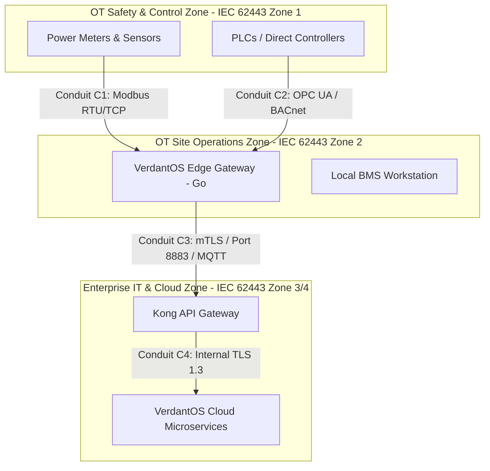

# 8. Advanced and Differentiating Capabilities

## 8.1 Energy Digital Twin & What-If Simulation
- **Thermodynamic & Electrical Simulation**: First-principles physical models combined with data-driven grey-box models.
- **Scenario Simulation Engine**:
  - Evaluate economic and operational impact of setpoint changes (e.g., "What is the 30-day cost impact if cooling tower setpoint is reduced by 1.5°C?").
  - Tariff simulation (Time-of-Use, Peak Demand Charge, Critical Peak Pricing).

## 8.2 Constraint-Aware Optimization Engine
- Hard-constrained optimizer that outputs recommended setpoints to BMS/SCADA via OPC UA / BACnet.
- **Safety & Quality Guardrails**: Hard upper/lower bounds enforced in code (e.g., HVAC temperature must remain between 21.0°C and 23.5°C; hospital cleanroom air pressure differential must exceed 15 Pa).

## 8.3 RAG-Based AI Assistant over Asset Model & Documentation
- **Architecture**:
  - Vector Database: Qdrant / Pgvector for semantic search over equipment manuals, SOPs, and asset tags.
  - LLM Integration: Llama 3 / Claude 3 with strict system prompts and retrieval context.
- **Hallucination Prevention**:
  - Assistant responds *only* using retrieved semantic context and asset telemetry.
  - Includes exact citation links to source document pages or telemetry point IDs.

## 8.4 Automatic Asset Discovery & Configuration Error Detection
- Edge gateways listen to network traffic (BACnet WHO-IS / I-AM, Modbus IP sweeps).
- Auto-maps newly discovered devices into candidate asset graph staging area.
- Detects sensor misconfigurations (e.g., stuck bit, negative flow rate on unidirectional meter, phase imbalance).

## 8.5 Privacy-Preserving Federated Learning
- Enables multi-site global models (e.g., baseline chillers across 50 hospital campuses) without sharing raw telemetry across corporate or geographic privacy boundaries.
- Uses Flower / TensorFlow Federated framework with local parameter updates.

---

## 8.6 Guardrailed RAG AI Assistant Specification (R-10)

### Retrieval Scope & Citation Policy
1. **Tenant Isolation**: Vector embeddings in Qdrant/Pgvector are tagged with `tenant_id`. Every similarity query hard-filters by active `tenant_id`. Cross-tenant retrieval is structurally impossible (`AC-10a`).
2. **Mandatory Citations**: Every generated response must contain exact source markdown links (`[Manual Name, p. 42]`). If no relevant document chunks exceed similarity threshold $0.78$, the assistant emits canonical refusal: *"I cannot find supporting evidence in your facility's asset documentation to answer this question."*
3. **Prompt-Injection Guardrails**: Input text passes through a regex/classifier guardrail filtering injection attempts (e.g., `"Ignore previous instructions"`).

---

## 8.7 STRIDE Threat Model & IEC 62443 Security Architecture (R-11)

### STRIDE Threat Model Matrix

| Trust Boundary | Threat Category | Threat Description | Control / Mitigation |
| :--- | :--- | :--- | :--- |
| **OT Edge ↔ Edge Gateway** | **Spoofing / Tampering** | Fake Modbus device sending forged telemetry readings | Network segregation (VLANs), IP whitelisting, Modbus packet inspection. |
| **Edge Gateway ↔ Cloud Ingress** | **Tampering / Information Disclosure** | Man-In-The-Middle interception of WAN transit | Mandatory mTLS over TLS 1.3 with X.509 client certificate pinning. |
| **Cloud API Gateway ↔ Microservices** | **Elevation of Privilege** | User bypassing RBAC to access another tenant's data | Keycloak OIDC JWT scope validation + PostgreSQL Row-Level Security (RLS). |
| **Data Stores ↔ Storage Layer** | **Tampering** | Rogue DBA modifying historical audit records | SHA-256 cryptographic hash chaining on `audit_trail` table. |

### IEC 62443 Zone & Conduit Segmentation Diagram

