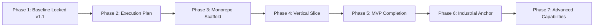

# Phase 2 — Execution Plan, Architectural Spine & Traceability Coverage

## 1. Executive Summary & Gate Discipline
This document establishes the delivery operating model, gate structure, critical path, architectural spine, and bidirectional traceability matrix coverage for VerdantOS development across Phases 2 through 7.

## 2. Phase Gate Structure

---

## 3. Explicit Architectural Spine List (Exact 6 Services)
The **Architectural Spine** represents the absolute minimal sequential set of components that must exist before any feature can be validated end-to-end. Phase 3 contains exactly these 6 spine services — no more, no fewer:

1. `db/migrations`: PostgreSQL DDL + TimescaleDB Hypertables + Multi-tenant RLS Policies (`AC-03a`, `AC-03d`).
2. `services/ingestion`: Go-based protocol ingestion, schema validation, and Protobuf serialization (`AC-01b`).
3. `services/semantic-graph`: Java/Go asset hierarchy service managing ltree paths and Brick/Haystack tags (`AC-01b`).
4. `services/enpi-engine`: Python EnPI formula DSL evaluator, MLR baseline solver, and CUSUM aggregator (`AC-07a`).
5. `services/anomaly-stream`: Real-time Tri-State anomaly decision classifier with Redis sliding window (`AC-08a`).
6. `services/audit-service`: Immutable SHA-256 cryptographic hash-chain ledger writer (`AC-11b`).

---

## 4. Bidirectional Traceability Matrix Coverage Counts
- **Total ISO 50001 Traceability Rows in `17-traceability.md`**: 24
- **Traceability Rows Mapped to Backlog Items (`BACKLOG.md`)**: 24
- **Unmapped Traceability Rows**: 0
- **Coverage Status**: 100% Bidirectional Mapping Confirmed (`AC-01a`, `AC-01b`, `AC-01c`, `AC-01d`).
